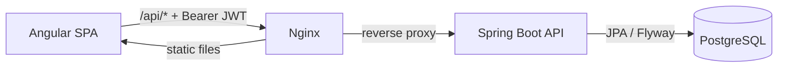

# OrderHub

Inventory and order management for a B2B distributor: a **Spring Boot 3 / Java 21** REST API and an **Angular 22** single-page app. Staff place orders against live stock, the API reserves inventory transactionally, and an order moves through a validated lifecycle from *pending* to *delivered* (or *cancelled*, which returns its stock to the shelf).

[](https://github.com/YOUR_GITHUB_USERNAME/orderhub/actions/workflows/ci.yml)


## Features

- **Stock-safe ordering** – placing an order reserves stock for every line in one transaction; it either fully succeeds or changes nothing. Optimistic locking (`@Version`) prevents overselling under concurrent requests.
- **Order lifecycle as a state machine** – `PENDING → CONFIRMED → SHIPPED → DELIVERED`, with cancellation allowed until shipping. Illegal transitions are rejected with `422`, and the API tells the UI which transitions are currently allowed.
- **Role-based access** – stateless JWT auth; `ADMIN` manages the catalogue, `STAFF` runs customers and orders. Enforced server-side with `@PreAuthorize` and mirrored in the UI.
- **Overview dashboard** – 30-day revenue, 14-day revenue trend, orders by status, best sellers and low-stock alerts.
- **Consistent errors** – every error is an RFC 9457 `application/problem+json` response, including per-field validation messages.
- **Interactive API docs** – OpenAPI 3 / Swagger UI with bearer-token support.

## Tech stack

| Layer | Technology |
| --- | --- |
| API | Java 21, Spring Boot 3.5, Spring Web MVC, Spring Data JPA (Hibernate), Bean Validation |
| Security | Spring Security 6, OAuth2 Resource Server (HS256 JWT), BCrypt |
| Database | PostgreSQL 16, Flyway migrations |
| Docs | springdoc-openapi (Swagger UI) |
| Front end | Angular 22 (standalone components, signals, new control flow), RxJS, typed reactive forms |
| Testing | JUnit 5, AssertJ, MockMvc, **Testcontainers** (real PostgreSQL), Vitest |
| Delivery | Docker multi-stage builds, Docker Compose, nginx, GitHub Actions, Dependabot |

## Architecture



The back end is organised **by feature** (`product`, `customer`, `order`, `dashboard`, `auth`) rather than by technical layer, so each business capability is self-contained. Business rules live in the domain model: `SalesOrder` and `Product` enforce stock and lifecycle invariants, which keeps services thin and lets the rules be unit-tested without Spring.

```
backend/src/main/java/com/orderhub
├── auth/            login + current user
├── security/        JWT encoding/decoding, filter chain, CORS
├── product/         catalogue + stock rules
├── customer/
├── order/           SalesOrder aggregate, OrderStatus state machine
├── dashboard/       aggregate queries for the overview
└── common/          problem-detail error handling, paging envelope
```

## Getting started

### Run everything with Docker

```bash
cp .env.example .env          # optional: set your own JWT secret
docker compose up --build
```

| Service | URL |
| --- | --- |
| Web app | http://localhost:4200 |
| API | http://localhost:8080 |
| Swagger UI | http://localhost:8080/swagger-ui.html |

Demo accounts (seeded on first start, disable with `SEED_USERS=false`):

| Role | Email | Password |
| --- | --- | --- |
| Admin | `admin@orderhub.dev` | `Admin123!` |
| Staff | `staff@orderhub.dev` | `Staff123!` |

### Run locally for development

Requirements: JDK 21, Maven 3.9+, Node 24 (or 22.22.3+), Docker (for PostgreSQL and the integration tests).

```bash
docker compose up -d db                    # PostgreSQL only

cd backend && mvn spring-boot:run          # API on :8080

cd frontend && npm ci && npm start         # UI on :4200, proxies /api to :8080
```

## API overview

| Method | Path | Role | Description |
| --- | --- | --- | --- |
| `POST` | `/api/auth/login` | public | Exchange credentials for a JWT |
| `GET` | `/api/auth/me` | any | Current user |
| `GET` | `/api/products?search=&page=&size=&sort=` | any | Search active products |
| `POST` / `PUT` / `DELETE` | `/api/products[/{id}]` | ADMIN | Create, update, archive |
| `GET` / `POST` / `PUT` | `/api/customers[/{id}]` | any | Search, create, update customers |
| `GET` | `/api/orders?status=` | any | List orders (paged, newest first) |
| `POST` | `/api/orders` | any | Place an order (reserves stock) |
| `GET` | `/api/orders/{id}` | any | Order with line items and allowed transitions |
| `PATCH` | `/api/orders/{id}/status` | any | Advance or cancel an order |
| `GET` | `/api/dashboard/summary` | any | KPIs for the overview page |

Example error:

```json
{
  "type": "https://orderhub.dev/problems/business-rule",
  "title": "Business rule violated",
  "status": 422,
  "detail": "Insufficient stock for MS-ERG-002: requested 12, available 8"
}
```

## Testing

```bash
cd backend && mvn verify       # unit tests + integration tests against PostgreSQL in Docker
cd frontend && npm test        # Vitest unit tests
```

- **Domain unit tests** cover stock reservation, the order state machine and revenue bucketing, with no Spring context.
- **Integration tests** (`*IT`) boot the full application against a real PostgreSQL container, so Flyway migrations, JPA mappings, security rules and JSON contracts are tested together end to end.
- **Front-end tests** cover the auth session, the HTTP interceptor, error mapping, order total maths and UI components.

CI runs all of the above on every push and pull request, then builds the Docker images. A JaCoCo coverage report is attached to each run.

## Design decisions

- **Prices are captured on the order line.** Editing a product's price never rewrites historical orders.
- **Products are archived, not deleted.** Past orders keep referencing them; archived products disappear from search and can't be ordered.
- **Schema is owned by Flyway** (`ddl-auto: none`). Hibernate never alters the database.
- **Stateless JWT in `localStorage`** keeps the demo simple to deploy. For production with stricter threat models, an HttpOnly cookie + CSRF token, or a BFF, is the stronger choice.
- **Time is injected** via a `Clock` bean so time-dependent logic is deterministic in tests.

## License

[MIT](LICENSE)
